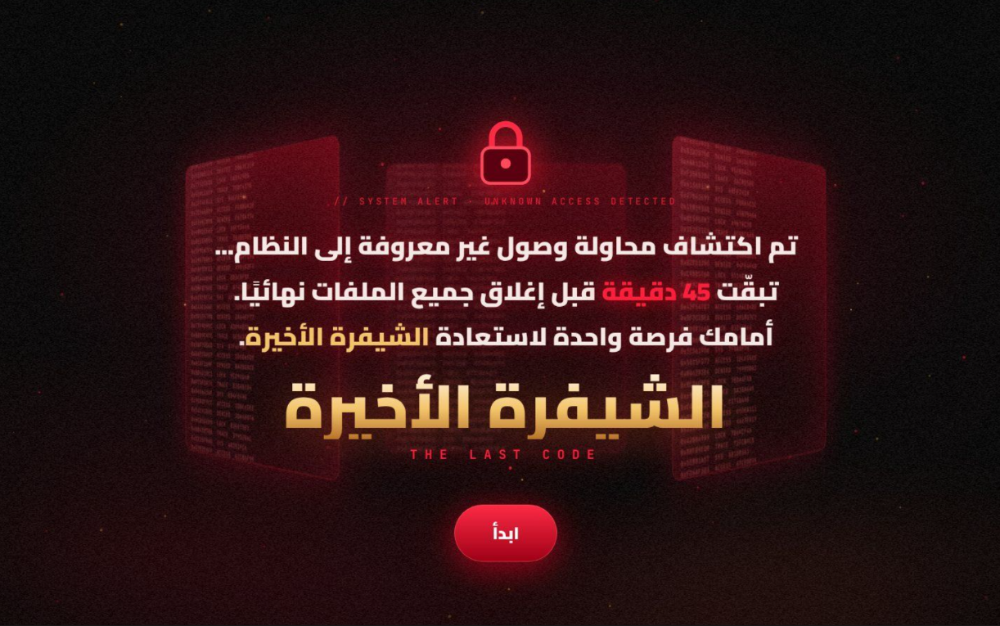
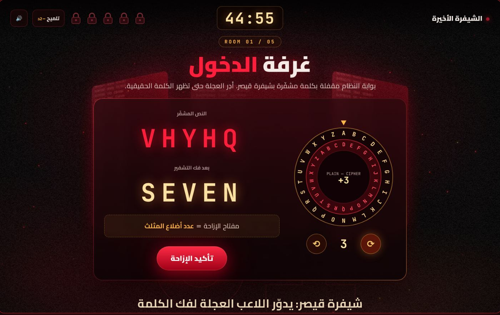
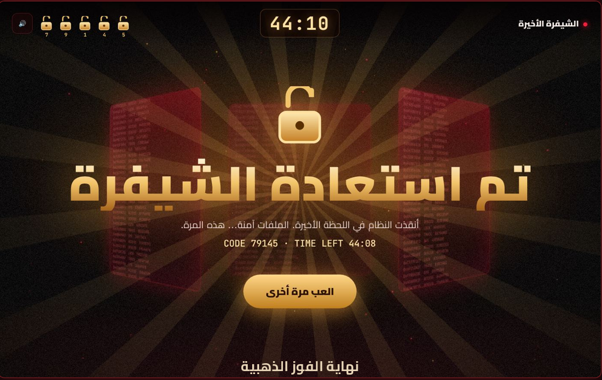
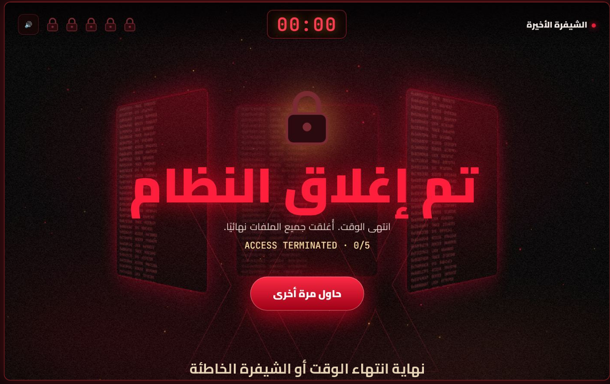

# 🔐 THE LAST CODE | الشيفرة الأخيرة

**An Arabic Cinematic Puzzle & Escape Experience**


---

## 🎮 Overview

**THE LAST CODE** is an Arabic cinematic puzzle game that combines logical reasoning, cryptography, pattern recognition, and interactive challenges within a mysterious digital environment.

Players must navigate five interconnected rooms, solve increasingly complex puzzles, and recover a final five-digit code before the 45-minute countdown reaches zero.

Every decision matters. Every second counts.

**Five rooms. Forty-five minutes. One final code.**

## 📸 Game Preview

| Screenshot 01 | Screenshot 02 |
|:---:|:---:|
|  |  |

| Screenshot 03 | Screenshot 04 |
|:---:|:---:|
|  |  |

## ✨ Key Features

- **Five interconnected puzzle rooms** — a progressive escape-room experience.
- **Cinematic atmosphere** — dark visuals, glowing interfaces, animated effects, and immersive transitions.
- **Cryptography challenges** — decode encrypted messages and uncover hidden information.
- **Logical problem-solving** — explore binary numbers, numerical sequences, and memory-based challenges.
- **45-minute countdown** — a time-sensitive experience with consequences for incorrect decisions.
- **Interactive hints** — optional assistance with a time penalty.
- **Multiple endings** — success or system shutdown based on the player's performance.
- **Arabic-first interface** — designed for an immersive right-to-left experience.

## 🧩 The Experience

| Stage | Room | Challenge |
|:---:|---|---|
| 01 | Entry Room | Cipher Decoding |
| 02 | File Room | Binary Decryption |
| 03 | Network Room | Sequence Recognition |
| 04 | Memory Room | Memory & Pattern Analysis |
| 05 | Decision Room | Final Logical Challenge |

Each completed room reveals a fragment of the final code, bringing the player closer to unlocking the system.

## 🛠️ Technologies

| Technology | Purpose |
|---|---|
| HTML5 | Game structure and interactive elements |
| CSS3 | Visual design, responsive layouts, and effects |
| JavaScript | Game logic, puzzles, timer, and interactions |
| GSAP | Cinematic animations and transitions |
| Cairo & JetBrains Mono | Arabic typography and technical interface styling |

## 📁 Project Structure

```text
The-Last-Code/
├── index.html
├── style.css
├── main.js
├── gsap.min.js
├── cairo-arabic-400-normal.woff2
├── cairo-arabic-700-normal.woff2
├── cairo-arabic-900-normal.woff2
├── cairo-latin-700-normal.woff2
├── cairo-latin-900-normal.woff2
├── jetbrains-mono-latin-500-normal.woff2
├── jetbrains-mono-latin-700-normal.woff2
└── README.md
```

## 🚀 Running the Project

The game is built using frontend web technologies and requires no backend service.

Once the project files are arranged with their correct asset paths, the experience can run locally in a modern web browser.

## 🎯 Project Vision

THE LAST CODE explores how interactive storytelling and logical challenges can transform problem-solving into an engaging digital experience.

The project combines software development, interface design, and game mechanics to create an experience in which observation, reasoning, and decision-making determine the outcome.

## 👩‍💻 Developed By

**Fay Naif**

Programmer | Data Analyst | UI/UX Designer

[GitHub](https://github.com/fay-naif)

---

*Decode the mystery. Recover the code. Beat the clock.*

**© 2026 Fay Naif — THE LAST CODE**
